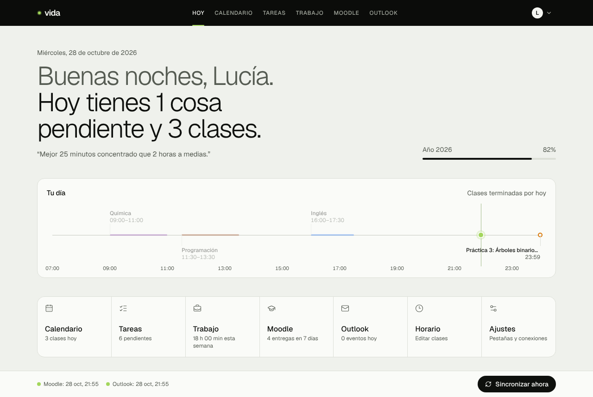
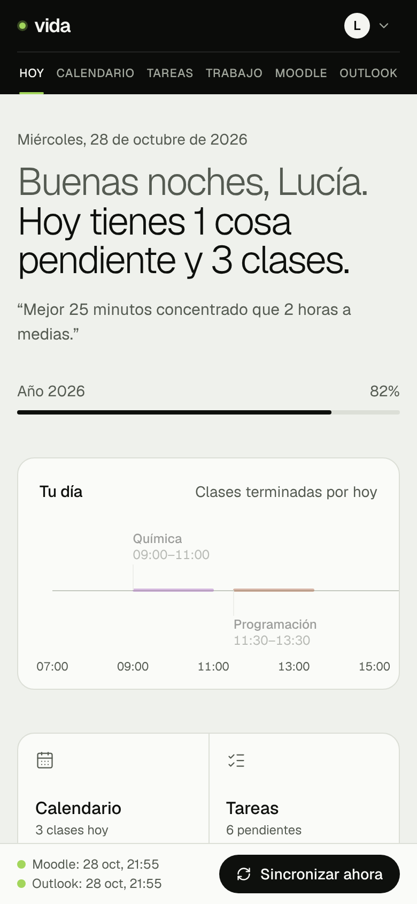
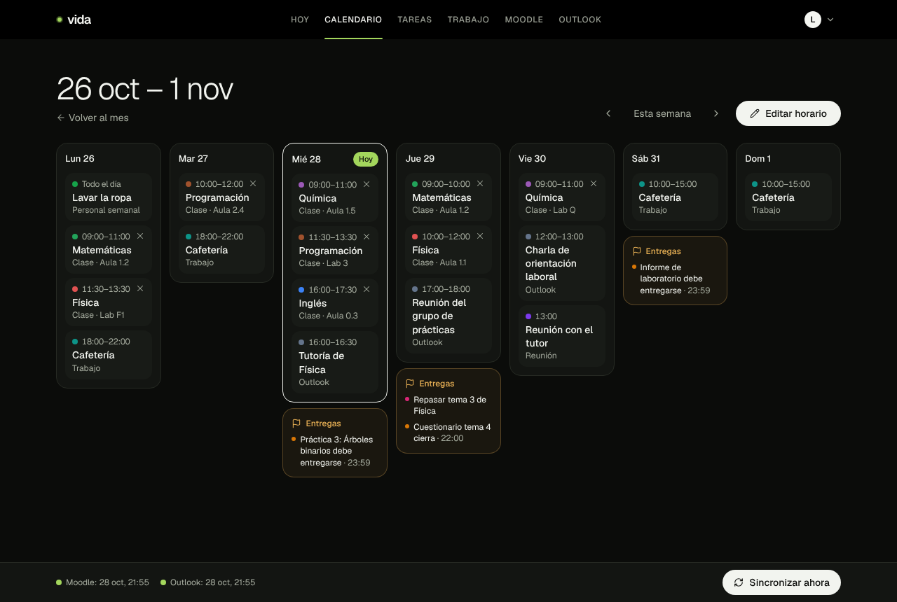
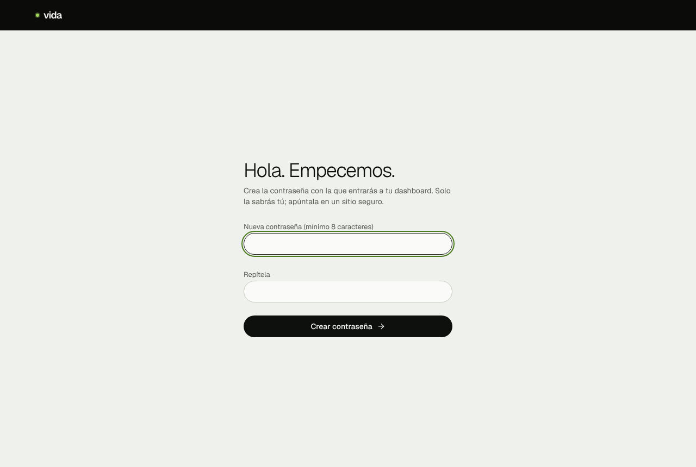
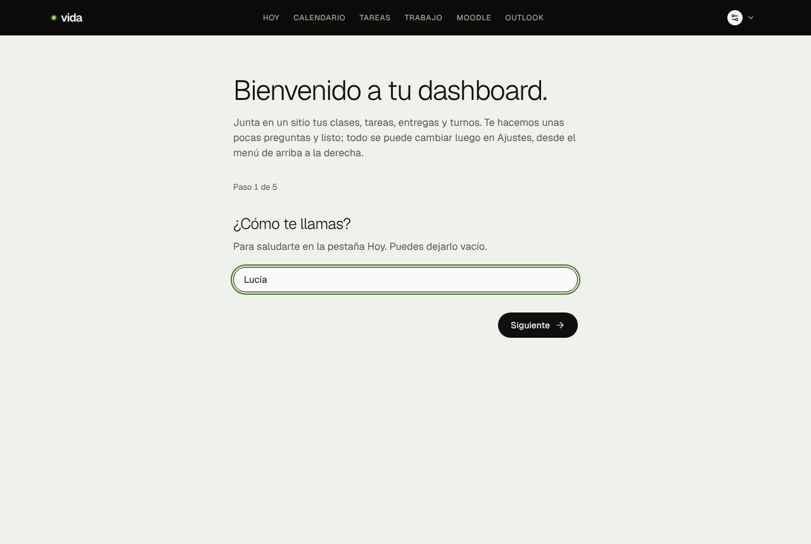
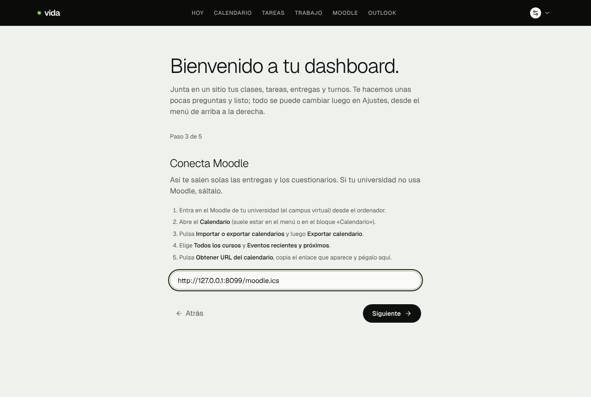

# Mi dashboard

Una web personal que junta en una sola pantalla **tus clases, tareas, entregas de Moodle, eventos de Outlook y turnos de trabajo**. Se instala en el móvil como si fuera una app, está en español y es gratis.

[](https://vercel.com/new/clone?repository-url=https%3A%2F%2Fgithub.com%2FMariporg1%2Fdashboard-vida-plantilla&project-name=mi-dashboard&repository-name=mi-dashboard&stores=%5B%7B%22type%22%3A%22integration%22%2C%22integrationSlug%22%3A%22neon%22%2C%22productSlug%22%3A%22neon%22%2C%22protocol%22%3A%22storage%22%7D%5D)



<p>
  
  
</p>

*(Las capturas usan datos inventados.)*

## Qué tiene

- **Hoy**: lo que te toca hoy, tus clases en una línea de tiempo, lo que vence pronto y cuentas atrás (fin de semana, próximo festivo, Navidad).
- **Calendario**: vista de mes y de semana, con tu horario de clases y tus días sin clase.
- **Tareas**: con tipo (tarea, entrega, examen, reunión, personal), prioridad, tareas que se repiten cada semana y tareas sin fecha.
- **Trabajo**: apunta tus turnos y ve las horas de la semana.
- **Moodle**: tus entregas y cuestionarios aparecen solos.
- **Outlook**: los eventos de tu calendario de Outlook.
- Modo claro, oscuro y automático. Se actualiza solo cada día y con el botón **Sincronizar ahora**.
- Protegido con contraseña: solo entras tú.

Cada pestaña se puede apagar si no la usas.

---

## Cómo tenerlo (10 minutos, sin programar)

Solo necesitas una cuenta de **GitHub** y otra de **Vercel**. Las dos son gratis.

### 1. Crea las cuentas (si no las tienes)

1. **GitHub**: entra en <https://github.com/signup> y crea una cuenta.
2. **Vercel**: entra en <https://vercel.com/signup>, elige el plan **Hobby** (gratis) y pulsa **Continue with GitHub**. Así quedan conectadas.

### 2. Pulsa el botón

1. Pulsa el botón **Deploy** de arriba (el negro que dice *Deploy*).
2. Vercel te pide un nombre para el repositorio. Puedes dejar `mi-dashboard` y pulsar **Create**.
3. Después te pide añadir la base de datos **Neon**. Pulsa **Add** (o **Connect**), acepta las condiciones y:
   - en *Region* elige **Frankfurt (eu-central-1)** si vives en España o Europa;
   - deja el plan gratuito (*Free*);
   - pulsa **Create** / **Continue** hasta que vuelva a la pantalla de Vercel.
4. Pulsa **Deploy** y espera 2 o 3 minutos. No tienes que rellenar ninguna variable.
5. Cuando salga el confeti, pulsa **Continue to Dashboard** y luego en **Visit** (o en el enlace que acaba en `.vercel.app`). Esa es tu web: guárdala en favoritos.

### 3. Entra la primera vez

Hazlo justo después de desplegar: la primera persona que entra es la que crea la contraseña.

1. Abre tu web. Te pide **crear una contraseña** (mínimo 8 caracteres). Apúntala en un sitio seguro.

   

2. Un asistente te pregunta, paso a paso:
   - **tu nombre**, para saludarte;
   - **qué pestañas quieres** (quita las que no uses);
   - el **enlace de tu calendario de Moodle** (te explica dónde está; puedes saltarlo);
   - el **enlace de tu calendario de Outlook** (igual, se puede saltar).

   

3. Pulsa **Empezar**. ¡Ya está!

Lo que te saltes lo puedes añadir cuando quieras en **Ajustes** (menú redondo de arriba a la derecha).

### 4. Añade tu horario

Ve a **Calendario → Editar horario**:

- En **Añadir clase** escribe la asignatura, el día, la hora y el periodo (de qué fecha a qué fecha hay clase).
- Más abajo, en **Días sin clase**, añade los festivos, puentes y vacaciones de tu universidad. Esos días no saldrán clases.
- Si un día concreto no hay una clase, en la vista de semana pulsa la **X** que hay sobre ella.

### 5. Instálalo en el móvil

- **Android (Chrome)**: abre tu web, menú **⋮** → **Instalar aplicación** (o *Añadir a pantalla de inicio*).
- **iPhone (Safari)**: abre tu web, botón **Compartir** → **Añadir a pantalla de inicio**.

---

## Dónde están los enlaces de calendario

El asistente y la pantalla de Ajustes te lo explican, pero aquí va también:

### Moodle (campus virtual)



1. Entra en el Moodle de tu universidad desde el ordenador.
2. Abre el **Calendario** y pulsa **Importar o exportar calendarios** → **Exportar calendario**.
3. Elige **Todos los cursos** y **Eventos recientes y próximos**.
4. Pulsa **Obtener URL del calendario** y copia el enlace.

El enlace no caduca y se actualiza solo. Con él ves todas las fechas de entrega. Si además quieres que desaparezca lo que ya has entregado, en **Ajustes → Moodle** hay una opción avanzada para añadir un token (no funciona en todas las universidades).

### Outlook

1. Abre <https://outlook.office.com/calendar>.
2. Rueda de **Configuración** → **Calendario** → **Calendarios compartidos**.
3. En **Publicar un calendario**, elige tu calendario y **Puede ver todos los detalles**, y pulsa **Publicar**.
4. Copia el enlace **ICS**.

Si tu universidad no deja publicar calendarios, simplemente apaga la pestaña Outlook.

---

## Preguntas frecuentes

**¿Cuánto cuesta?** Nada. Vercel (plan Hobby) y Neon (plan Free) son gratis para uso personal y este dashboard gasta muy poco.

**¿Se me ha olvidado la contraseña?** En Vercel, entra en tu proyecto → pestaña **Storage** → tu base de datos Neon → **Open in Neon** → **SQL Editor**, escribe esto y pulsa **Run**:

```sql
update settings set password_hash = null;
```

Al abrir tu web te pedirá crear una contraseña nueva. Tus datos no se borran.

**¿Cada cuánto se actualiza?** Una vez al día de forma automática (de madrugada) y siempre que pulses **Sincronizar ahora** en la barra de abajo.

**¿Y las mejoras de esta plantilla?** Tu copia es tuya y no cambia sola. Si sale algo nuevo que te interese, puedes copiar los cambios a tu repositorio; cada vez que cambia tu repositorio, Vercel vuelve a publicar la web sola.

**¿Mis datos son privados?** Sí. Tus tareas, horario y enlaces se guardan en tu propia base de datos de Neon y solo se ven con tu contraseña. Nadie más (tampoco quien hizo esta plantilla) tiene acceso.

**Algo no funciona.** Mira la barra de abajo: si una conexión sale en rojo, pasa el ratón (o mantén pulsado) para ver el motivo. En Ajustes puedes volver a pegar el enlace.

---

## Para quien sabe programar

**Stack:** Next.js 15 (App Router, TypeScript) · Tailwind 4 · Postgres con Drizzle · Vercel (cron diario en `vercel.json`).

### Variables de entorno

Solo `DATABASE_URL` es obligatoria (la crea la integración de Neon). Todo lo demás se configura dentro de la app y se guarda en la tabla `settings`. Si defines alguna de estas variables, manda sobre lo guardado:

| Variable | Para qué |
|---|---|
| `DATABASE_URL` | Postgres. También se acepta `POSTGRES_URL`. Las migraciones usan `DATABASE_URL_UNPOOLED` si existe. |
| `AUTH_SECRET` | Firma de la cookie. Sin ella se deriva de `DATABASE_URL`. |
| `AUTH_PASSWORD_HASH` | Contraseña fija (`npm run hash-password -- "…"`). Sin ella se crea en la primera visita. |
| `CRON_SECRET` | Protege `/api/cron/sync`. Sin ella, la ruta solo responde `ok` y sincroniza como mucho cada 15 min. |
| `MOODLE_ICAL_URL`, `MOODLE_TOKEN`, `MOODLE_URL`, `OUTLOOK_ICS_URL` | Alternativa a pegarlos en Ajustes. |

### En local

Necesitas Node 20+ y un Postgres (por ejemplo `docker run -d -e POSTGRES_HOST_AUTH_METHOD=trust -e POSTGRES_DB=dashboard -p 5432:5432 postgres:16`).

```bash
npm install
cp .env.example .env.local   # y ajusta DATABASE_URL
npm run db:migrate
npm run dev                  # http://localhost:3000
```

Tests: `npm test`. Los de sincronización usan una base de datos real; pásala con `TEST_DATABASE_URL=postgres://…/dashboard_test npm test` (sin ella se saltan).

La zona horaria está fijada en `Europe/Madrid` (`src/lib/dates.ts`).

## Licencia

[MIT](LICENSE). Úsalo, cámbialo y compártelo como quieras.
